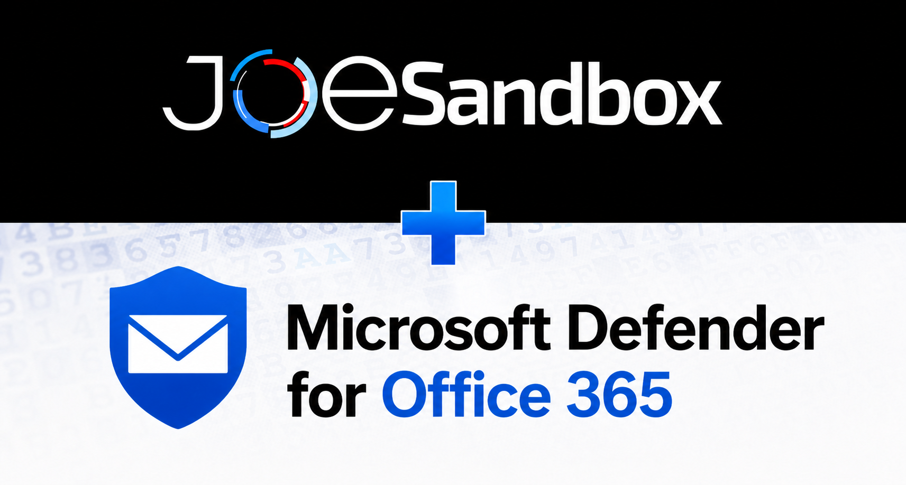

# Joe Sandbox for Microsoft Defender for Office 365

This Azure Function integrates Microsoft Defender for Office 365 with Joe Sandbox. It monitors Defender alerts, submits the associated email for analysis, and writes the Joe Sandbox result back to Microsoft Defender.


## Requirements

- Microsoft Defender for Office 365 and Microsoft Defender XDR.
- A Joe Sandbox Cloud API key.
- An Azure subscription and resource group.
- A Log Analytics workspace for Application Insights.
- Permission to create a Microsoft Entra application and grant administrator consent.

## 1. Create the Microsoft Entra application

1. Open the [Azure portal](https://portal.azure.com/).
2. Go to **Microsoft Entra ID** → **App registrations** → **New registration**.
3. Enter a name such as `JoeSandboxDefenderO365`.
4. Select **Accounts in this organizational directory only** and register the application.
5. Record the **Application (client) ID** and **Directory (tenant) ID**.

### Add Microsoft Graph permissions

Open **API permissions**, select **Add a permission** → **Microsoft Graph** → **Application permissions**, and add:

| Permission | Purpose |
| --- | --- |
| `SecurityAlert.ReadWrite.All` | Read Defender alerts and add Joe Sandbox comments |
| `Mail.Read` | Retrieve the email associated with an alert |
| `SecurityIncident.ReadWrite.All` | Add tags and optional analysis comments to related incidents |

Select **Grant admin consent** after reviewing the permissions.

### Add Microsoft Defender for Endpoint permission

In **API permissions**, select **Add a permission** → **APIs my organization uses**, search for `WindowsDefenderATP`, select **Application permissions**, and add:

| Permission | Purpose |
| --- | --- |
| `Ti.ReadWrite.All` | Read existing indicators and create new indicators from Joe Sandbox IOCs |

Grant admin consent for this permission as well. It is not required when `IndicatorImportEnabled=false`.

### Create the client secret

1. Open **Certificates & secrets** → **Client secrets** → **New client secret**.
2. Select an appropriate expiration period.
3. Copy the secret **Value** immediately.

Use the secret value, not the secret ID, during deployment.

## 2. Deploy the Azure Function

Choose the hosting plan that fits your Azure environment.

### Flex Consumption

[](https://portal.azure.com/#create/Microsoft.Template/uri/https%3A%2F%2Fraw.githubusercontent.com%2Fjoesecurity%2FJoe-Sandbox-Microsoft-Defender-Office365%2Frefs%2Fheads%2Fmain%2FFunctionApp%2Fazuredeploy.json)

Flex Consumption is recommended when it is available in the resource group's region. See the current [supported regions](https://learn.microsoft.com/en-us/azure/azure-functions/flex-consumption-plan#view-currently-supported-regions).

### Elastic Premium

[](https://portal.azure.com/#create/Microsoft.Template/uri/https%3A%2F%2Fraw.githubusercontent.com%2Fjoesecurity%2FJoe-Sandbox-Microsoft-Defender-Office365%2Frefs%2Fheads%2Fmain%2FFunctionApp%2Fazuredeploy_premium.json)

Use the Premium template when Flex Consumption is unavailable or an Elastic Premium plan is required.

## 3. Complete the deployment fields

| Field | Value |
| --- | --- |
| **Subscription** | Azure subscription used for the Function App |
| **Resource group** | Resource group where the connector is deployed |
| **Region** | Azure region for the deployment |
| **Function Name** | Function App base name; default is `JoeSandboxDefenderO365` |
| **Azure Tenant ID** | Directory/tenant ID from the Entra application |
| **Azure Client ID** | Application/client ID from the Entra application |
| **Azure Client Secret** | Client-secret value created earlier |
| **App Insights Workspace Resource ID** | Full resource ID of the Log Analytics workspace |
| **Joe Sandbox Base URL** | Joe Sandbox URL without `/api`; cloud default is `https://jbxcloud.joesecurity.org` |
| **Joe Sandbox API Key** | API key with submission and analysis-read permissions |
| **Joe Sandbox Accept Terms** | Set to `true` only after accepting the applicable Joe Sandbox terms |

Select **Review + create**, verify the settings, and start the deployment.

## 4. Verify the installation

After deployment:

1. Open the deployed Function App in the Azure portal.
2. Confirm that the `JoeSandboxDefenderO365` function is listed.
3. Open **Application Insights** or **Log stream** and confirm that the polling timer runs without authentication errors.
4. Wait for a Microsoft Defender for Office 365 alert containing analyzed-message evidence.
5. Confirm that the related Defender alert receives a Joe Sandbox submission comment.
6. After analysis completes, confirm that the result comment and optional incident enrichment are present.
7. For a malicious or suspicious result with malicious IOCs, open **Microsoft Defender** → **Settings** → **Endpoints** → **Indicators** and confirm the Joe Sandbox indicators are present.

The first run checks the previous 60 minutes by default. Increase `InitialLookbackMinutes` if the test alert is older.

## Optional configuration

Use the setting names below when deploying or updating the connector. Existing
deployments using the earlier names must rename those application settings or
redeploy with the updated template and package; legacy names are not read.

| Setting | Default | Description |
| --- | --- | --- |
| `PollIntervalMinutes` | `5` | Polling interval accepted by the ARM templates: 1–10 minutes |
| `InitialLookbackMinutes` | `60` | Alert history checked on the first run |
| `AlertOverlapMinutes` | `15` | Overlap applied to the saved polling watermark |
| `AlertSeverities` | `informational,low,medium,high` | Comma-separated alert severities to process |
| `IncidentTagsEnabled` | `true` | Add verdict and threat-name tags to related incidents |
| `IncidentCommentsEnabled` | `false` | Add the analysis result to related incidents with comment deduplication |
| `IndicatorImportEnabled` | `true` | Create Defender indicators from malicious Joe Sandbox IOCs |
| `IndicatorVerdicts` | `malicious,suspicious` | Analysis verdicts eligible for indicator creation |
| `IndicatorLifetimeDays` | `30` | Number of days before created indicators expire |
| `MaliciousNetworkAction` | `Block` | Action for URL, domain, and IP indicators from malicious analyses |
| `SuspiciousNetworkAction` | `Audit` | Action for URL, domain, and IP indicators from suspicious analyses |
| `MaliciousFileAction` | `Block` | Action for file-hash indicators from malicious analyses |
| `SuspiciousFileAction` | `Audit` | Action for file-hash indicators from suspicious analyses |
| `IndicatorAlertsEnabled` | `false` | Generate matching alerts; automatically treated as `true` for `Audit` actions |
| `JoeSandboxResubmit` | `false` | Submit again when an analysis for the same email already exists |
| `JoeSandboxAnalysisJobTimeout` | `30` | Maximum minutes to wait for a completed analysis |
| `JoeSandboxPollIntervalSeconds` | `30` | Delay between submission-status checks |
| `JoeSandboxAPIMaxRetry` | `5` | Joe Sandbox API retry count |
| `JoeSandboxAPIRetryTimeout` | `5` | Joe Sandbox API timeout in minutes |
| `MicrosoftRetryCount` | `3` | Microsoft Graph retry count |
| `MicrosoftRetryDelaySeconds` | `60` | Default retry delay in seconds |
| `MicrosoftHttpTimeoutSeconds` | `120` | Timeout for each Graph request in seconds |

The Premium template additionally supports `FunctionAppPlanSku` (`EP1`, `EP2`, or `EP3`) and `StorageAccountType` (`Standard_LRS`, `Standard_GRS`, or `Standard_RAGRS`).

## Behavior notes

- The connector uses the alert evidence's recipient mailbox and Internet Message-ID to locate the email.
- It submits the complete email to Joe Sandbox; URLs and attachments are not sent as additional individual submissions.
- Each new raw-EML submission receives a unique `MDO-<32-hex UUID>` Joe Sandbox tag. The same tag is recorded in the related Defender alert comment for correlation.
- When one EML produces multiple analyses, the connector uses `submission_info().most_relevant_analysis`, selected by Joe Sandbox, for comments and IOC enrichment.
- After analysis, it downloads Joe Sandbox IRJSON and creates Defender indicators only for entries explicitly marked malicious: URLs, domains, IP addresses, and MD5/SHA-1/SHA-256 file hashes. Existing Defender indicators are left unchanged.
- Duplicate email content is identified by SHA-256 to avoid unnecessary submissions.
- Submission and analysis information is added to every related Defender alert.
- `SecurityIncident.ReadWrite.All` is not needed when both `IncidentTagsEnabled=false` and `IncidentCommentsEnabled=false`.

Email can contain sensitive business data. Ensure that the configured Joe Sandbox instance and retention policy meet your organization's requirements.

## Troubleshooting

| Problem | Check |
| --- | --- |
| No alerts are processed | Verify `SecurityAlert.ReadWrite.All`, admin consent, severity selection, and the initial lookback period |
| Alert found but email skipped | Verify `Mail.Read`, mailbox access, and that the alert contains recipient and Internet Message-ID evidence |
| Joe Sandbox authentication fails | Verify the base URL, API key, API permissions, and terms setting |
| Indicator creation fails | Verify `WindowsDefenderATP` application permission `Ti.ReadWrite.All`, admin consent, and the configured indicator actions |
| Incident enrichment fails | Grant `SecurityIncident.ReadWrite.All`, or disable both incident tags and comments |
| Flex deployment is unavailable | Select a supported region or use the Elastic Premium template |

## Offline validation

The included tests use synthetic data and do not require MDO or submit anything externally:

```bash
python3 -m unittest discover -s tests -v
```

Local development settings are documented in [`FunctionApp/local.settings.example.json`](FunctionApp/local.settings.example.json). Never commit real API keys or client secrets.

## Source layout

The timer and polling watermark are managed in `app.py`. Email processing and
submission recovery live in `workflow.py`, with clients supplied by the caller
for offline testing. `reporting.py` formats Defender comments and tags, while
`lib/` contains the Microsoft and Joe Sandbox API clients, email models, and
IRJSON indicator parser.
